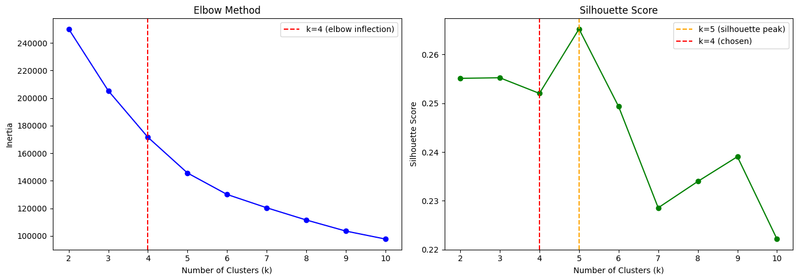
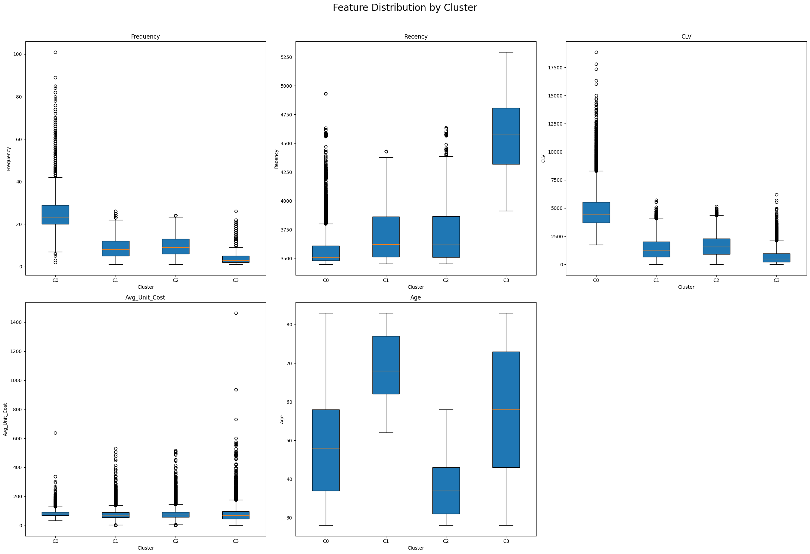
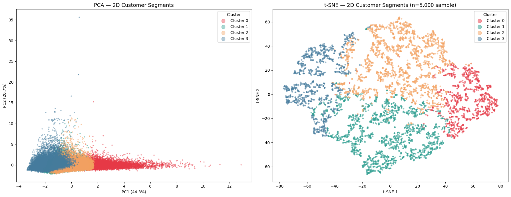

# Customer Segmentation with Clustering

Grouping 68,300 e-commerce customers into four segments for targeted marketing, using K-Means, hierarchical clustering, PCA and t-SNE.

**Author:** Thein Than Arkar · University of Cambridge (PACE) Data Science Career Accelerator

## The problem

Personalised marketing works better than one-size-fits-all campaigns, but first you need to know which customers behave alike. This project segments the customers of a global online retailer using SAS's public CUSTOMERS_CLEAN dataset: **951,668 orders from 47 countries, placed between 2012 and 2016**.

## Approach

1. **Cleaning:** removed 21 duplicate rows, dropped location columns that weren't needed (e.g. 117,192 missing State/Province values), and fixed date and currency formats.
2. **Feature engineering:** grouped orders by customer to build five features, one row per customer:

| Feature | Definition | Why it matters |
|---|---|---|
| Frequency | Number of unique orders | Loyalty and engagement |
| Recency | Days since the most recent delivery | Churn risk |
| CLV | Total revenue from the customer (USD) | Customer value |
| Average Unit Cost | Mean price of items bought | Spending tier |
| Age | Customer age in years | Demographics |

3. **Outliers:** checked with the 1.5 × IQR rule (at most 4.9% per feature). High CLV and Frequency outliers were kept, because they are real high-value customers, not errors.
4. **Scaling:** `StandardScaler` inside a `ColumnTransformer` pipeline, so that CLV (thousands) doesn't drown out Frequency (single digits) in the distance calculations.
5. **Choosing k:** compared the elbow method, silhouette scores and a Ward-linkage dendrogram.
6. **Clustering:** K-Means with k = 4.
7. **Visualisation:** PCA on all customers and t-SNE on a 5,000-customer sample.

## Choosing the number of clusters

The elbow levels off at k = 4 and the dendrogram splits into four clear branches. The silhouette score is slightly higher at k = 5 (0.265 vs 0.252), but the gap is small, and four segments are easier for a marketing team to act on, so I chose **k = 4**.

## Results

K-Means produced four segments of reasonable size (about 11,600 to 23,700 customers each) with a silhouette score of **0.252**. That's moderate separation, which is normal for real customer behaviour where groups overlap at the edges.

| Segment | Customers | What the data shows |
|---|---|---|
| **High-value loyalists** (C0) | 11,619 | Most orders, most recent activity, highest lifetime value by far |
| **Older regular customers** (C1) | 21,302 | Medium order count and value; mostly aged about 60–77 |
| **Younger regular customers** (C2) | 23,665 | Medium order count and value; mostly aged about 31–43 |
| **Lapsed customers** (C3) | 11,714 | Fewest orders, longest time since last delivery, lowest value |

The two biggest segments buy in similar amounts but are split mainly by **age**, which suggests different messaging rather than different offers.

The first two principal components explain **65.1%** of the variance. PCA shows the segments spreading along PC1 with blurred edges; t-SNE separates them into much clearer groups. (In t-SNE, the distance *between* groups isn't meaningful, only which points group together.)

## Recommendations

| Segment | Suggested marketing action |
|---|---|
| High-value loyalists | Protect them: early access, loyalty rewards and premium service |
| Older regular customers | Upsell with bundles and recommendations, using channels and messaging suited to an older audience |
| Younger regular customers | Upsell with bundles and recommendations, using channels and messaging suited to a younger audience |
| Lapsed customers | Win them back: time-limited discount codes and personalised reminders |

## Limitations and next steps

- Clustering has no "right answer" to check against, so the segments should be reviewed with the marketing team before use.
- Future work could add features such as order type or continent, try density-based methods like DBSCAN for the irregular t-SNE shapes, and refresh the segments regularly.

## Tools

Python, pandas, NumPy, scikit-learn (K-Means, PCA, t-SNE, pipelines), SciPy (hierarchical clustering), Matplotlib, seaborn. Built in Google Colab.

## Running the notebook

Open `customer_segmentation.ipynb` in Google Colab or Jupyter. The data loads automatically from the course's public GitHub dataset, and all outputs are saved in the notebook.

## Reference

SAS (2024). CUSTOMERS_CLEAN [Data set]. SAS. Last revised 15 December 2021.
